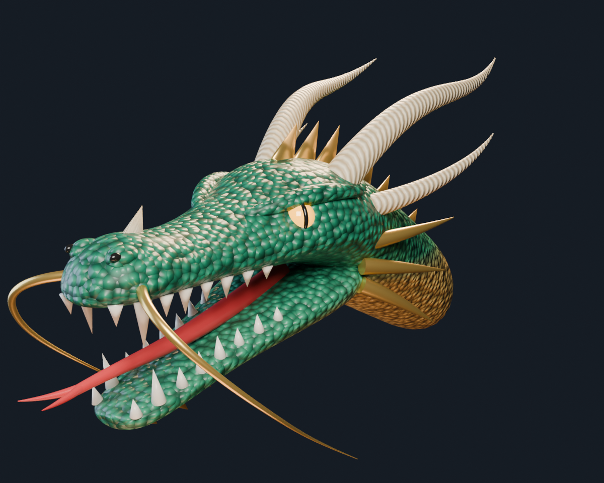

# Naga 3D 🐉

Kepala naga 3D yang dibuat 100% lewat kode, dalam dua versi:

- **Web (Three.js)**: `naga_threejs.html`, model dibangun langsung di browser. Bisa diputar dengan mouse atau sentuhan.
- **Blender**: `build_naga.py`, script Blender Python yang membuat model, `naga_head.blend`, ekspor `naga_head.glb`, dan render.

**Demo live:** https://a-rzky.github.io/naga3d/



## Cara pakai

### Versi web
Buka `naga_threejs.html` di browser (butuh internet karena Three.js diambil dari CDN), atau langsung buka link demo di atas.

### Versi Blender (4.x)
```bash
blender --background --python build_naga.py -- --render --samples 64 --size 1200
```
Output tersimpan di folder yang sama: `naga_head.blend`, `naga_head.glb`, dan `render_*.png`.

## Isi repo

| File | Keterangan |
|---|---|
| `naga_threejs.html` | Versi web Three.js (self-contained) |
| `index.html` | Redirect ke versi web (untuk GitHub Pages) |
| `build_naga.py` | Script Blender prosedural |
| `naga_head.blend` | File Blender hasil script |
| `naga_head.glb` | Model glTF untuk web / game engine |
| `render_*.png` | Render pratinjau (depan, samping, tiga perempat) |

---
Dibuat oleh [Pande Digital](https://instagram.com/pande.digital).
